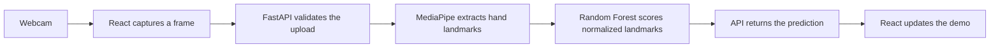

# AI-Powered Real-Time Hand Gesture Recognition

## Project overview

This application uses a webcam to recognize six hand gestures and control an interactive card demo in the browser. MediaPipe detects one hand and extracts 21 three-dimensional landmarks. The backend centers the landmarks at the wrist, normalizes their scale, and feeds them to a Random Forest classifier.

## Features

- Live camera preview with a gesture label, confidence score, hand-detection status, and recent predictions.
- Gesture-controlled card navigation, selection, and demo state with prediction stability checks and a command cooldown.
- Separate `unknown` and `no_hand` states. The former indicates that a hand was detected without a reliable classification. The latter indicates that MediaPipe found no hand.
- FastAPI endpoints for predictions, model readiness, model details, and evaluation metrics.
- Reproducible dataset preparation, model training, and held-out evaluation.

## Technology stack

| Layer | Tools |
| --- | --- |
| Frontend | React, Vite, JavaScript, CSS, browser MediaDevices API |
| Backend | Python 3.11, FastAPI, Uvicorn, Pydantic |
| Machine learning | MediaPipe Hands, OpenCV, NumPy, pandas, scikit-learn, joblib, Matplotlib |

## Supported gestures

| Gesture | Model label | Demo command |
| --- | --- | --- |
| Open palm | `palm` | Pause navigation |
| Closed fist | `fist` | Stop and reset the demo |
| Thumbs up | `like` | Confirm the current card and resume |
| Thumbs down | `dislike` | Clear the selection |
| Peace sign | `peace` | Advance to the next card |
| Pointing finger | `point` | Select the current card |

The frontend and backend share the mappings in [gesture_config.json](gesture_config.json).

## Architecture



React sends compressed JPEG frames through Vite's local `/api` proxy. FastAPI loads the trained model once at startup and returns the label, confidence, and mapped action. React executes a command only when the gesture meets its confidence, stability, and cooldown settings. Dataset preprocessing uses the same landmark normalization as live inference.

## Repository structure

| Path | Contents |
| --- | --- |
| `frontend/` | React pages, webcam capture, demo controls, and frontend tests |
| `backend/` | FastAPI service, response schemas, and Python tests |
| `ml/` | Dataset import, landmark preprocessing, training, evaluation, and inference |
| `datasets/` | Dataset documentation plus local raw and processed data |
| `artifacts/` | Trained model, evaluation reports, confusion matrices, and class distribution |
| `docs/` | Architecture, CRISP-DM, report, and presentation materials |
| `.github/workflows/`, `deployment/`, `scripts/` | Project scaffolding for automation, deployment, and utilities |

## Installation

Use Python 3.11 x64 and Node.js 22 or newer. Run the commands from the project root in PowerShell. If the project already has a virtual environment, check it first:

```powershell
.\.venv\Scripts\python.exe --version
```

If it reports Python 3.11, use it. To create a fresh environment, run the following if `python --version` reports Python 3.11:

```powershell
python -m venv .venv
.\.venv\Scripts\python.exe -m pip install -r backend/requirements.txt
```

You can also invoke a Python 3.11 executable by its full path. If Python 3.11 is unavailable on your PATH and you have `uv`, use this setup instead:

```powershell
uv python install 3.11
uv venv --python 3.11 .venv
uv pip install --python .\.venv\Scripts\python.exe -r backend/requirements.txt
```

Install the frontend dependencies. The optional environment files let you override the defaults:

```powershell
npm.cmd --prefix frontend ci
if (!(Test-Path .env)) { Copy-Item .env.example .env }
if (!(Test-Path frontend/.env)) { Copy-Item frontend/.env.example frontend/.env }
```

## Running the application

The backend loads `artifacts/models/random_forest.joblib` by default. If the artifact is missing, complete dataset preparation and training first. Load joblib files only from a trusted source.

Start the backend and frontend in separate PowerShell terminals from the project root:

```powershell
.\.venv\Scripts\python.exe -m uvicorn backend.app.main:app --host 127.0.0.1 --port 8000
```

```powershell
npm.cmd --prefix frontend run dev
```

Open [http://localhost:5173](http://localhost:5173), select **Live Recognition**, and click **Start recognition**. Allow camera access when prompted. See the [frontend guide](frontend/README.md) for the demo sequence and the [backend guide](backend/README.md) for a real-image API check.

## Dataset

The reference run used the 100-image-per-class HaGRIDv2 export from Gesture Detection Connoisseurs. The subset lists CC BY-SA 4.0 and upstream HaGRIDv2 publishes a modified version of that license. The dataset guide provides attribution, download instructions, and licensing links. [HaGRIDv2 subset](https://huggingface.co/datasets/GestureDetectionConnoisseurs/hagrid_subsets) · [Dataset guide](datasets/README.md)

Of the **600 original images** across the six selected classes, MediaPipe detected a hand in **529**, and **478** passed the annotation box check. The importer checks exact and near duplicates and uses a seeded, stratified subject-group split. Each source subject ID occurs in only one split.

| Split | Images | Subjects |
| --- | ---: | ---: |
| Training | 316 | 298 |
| Validation | 83 | 74 |
| Held-out test | 79 | 74 |

### Dataset preparation

```powershell
.\.venv\Scripts\python.exe -m ml.preprocessing.prepare --hagrid-subset 100
```

The command reuses or downloads the reference ZIP, verifies its checksum, and extracts the six classes and annotation files under `datasets/raw/`. It writes landmarks, split assignments, and rejected-image counts under `datasets/processed/`. Raw archives and image-level data stay local.

## Model training

```powershell
.\.venv\Scripts\python.exe -m ml.training.train_random_forest
```

The pipeline fits three candidates on the training split. It selects by validation macro F1, with accuracy as the tiebreaker. The selected reference model uses seed 42, 300 trees, balanced subsampling, `max_features="sqrt"`, and `min_samples_leaf=1`. The command writes the default model artifact and validation reports. Restart FastAPI after retraining to load a new artifact.

## Model evaluation

```powershell
.\.venv\Scripts\python.exe -m ml.evaluation.evaluate
```

Evaluation scores the saved model on the held-out split. The table below comes from the saved validation and test reports.

| Split | Accuracy | Macro precision | Macro recall | Macro F1 |
| --- | ---: | ---: | ---: | ---: |
| Validation (83 images) | 96.39% | 96.14% | 96.25% | 96.14% |
| Held-out test (79 images) | 100.00% | 100.00% | 100.00% | 100.00% |

The closed-set test scores cover only the 79 retained images. The split excludes photos that failed hand detection or annotation verification. At the default API confidence threshold of **0.70**, **76 of 79** test images received the correct gesture label and **three** returned `unknown`. These scores do not establish accuracy on live webcam footage or unsupported poses.

The reference reports include `model_metrics.json` and `classification_report.json` under [artifacts/metrics](artifacts/metrics/), plus the [validation confusion matrix](artifacts/figures/validation/confusion_matrix.png), [test confusion matrix](artifacts/figures/test/confusion_matrix.png), and [class distribution](artifacts/figures/class_distribution.png). Use `--help` on each command to choose alternate paths for a new run.

## Testing

```powershell
.\.venv\Scripts\python.exe -m pytest -q backend/tests
npm.cmd --prefix frontend test
npm.cmd --prefix frontend run build
```

## Current project status

- **Implemented and tested:** Subject-disjoint preprocessing, model training and evaluation, saved-model loading, API readiness and real-image inference, frontend build, and command stability logic.
- **Verified with dataset replay:** Chrome captured replayed HaGRID frames and sent them through FastAPI. The browser displayed confidence and both special states, executed all six commands, released the stream on Stop and navigation, and displayed a service error.
- **Physical webcam verification pending:** Follow the [manual camera checklist](frontend/README.md#physical-webcam-checklist) to check permissions, live video, recognition, and device release on your machine.

## Future work

- Compare CNN and MobileNet classifiers with the Random Forest baseline.
- Expand hyperparameter tuning and run ablation studies.
- Track experiments with MLflow and add an evaluation dashboard.
- Package the application for Docker and cloud deployment.
- Complete the CRISP-DM final documentation.

## Team contributions

| Group member | Contributions |
| --- | --- |
| | |
