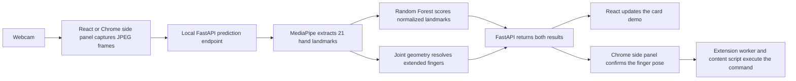

# AI-Powered Hand Gesture Recognition and Browser Control

This project turns webcam input into two experiences. A React dashboard uses a trained Random Forest to recognize six gestures and control a card demo. A Chrome extension uses stationary finger counts to scroll and navigate ordinary websites. Both clients send frames to the same local FastAPI service.

## Features

- Live webcam preview and MediaPipe hand-landmark detection.
- Six Random Forest gesture labels, confidence, and prediction history in the React dashboard.
- Stationary finger-count controls in a Chrome side panel, including continuous scrolling, eligible link highlighting and opening, and Back.
- Gesture stability checks, an automatic scrolling timeout, and optional local command diagnostics.
- Reproducible dataset preparation, model training, and held-out evaluation.

## System architecture



FastAPI returns the classifier's gesture, confidence, and demo action separately from the finger count, individual finger states, and pose quality. React consumes the classifier result. The extension consumes the landmark-based result. The extension processes commands only after recognition starts and Chrome grants access to the active page.

| Layer | Technology |
| --- | --- |
| React demo | React, Vite, JavaScript, CSS, MediaDevices |
| Chrome extension | Manifest V3, Side Panel API, service worker, content scripts |
| API | Python 3.11, FastAPI, Uvicorn, Pydantic |
| ML and evaluation | MediaPipe Hands, OpenCV, NumPy, pandas, scikit-learn, joblib, Matplotlib |

## Project structure

```text
.
├── artifacts/          Reference model, evaluation metrics, and figures
├── backend/            FastAPI service, schemas, and Python tests
├── browser-extension/  Unpacked Chrome extension and browser command tests
├── datasets/           Dataset guide and ignored local data
├── deployment/         Local serving guide
├── docs/               Coursework outlines and repository audit
├── frontend/           React dashboard and tests
├── ml/                 Dataset preparation, training, evaluation, and inference
└── gesture_config.json Shared classifier labels and React commands
```

## Prerequisites

- Windows PowerShell for the commands below.
- Python 3.11 (64-bit) for the pinned Python environment.
- Node.js 22 or newer with npm for the React app and JavaScript tests.
- Chrome 120 or newer for the extension, plus a webcam for live recognition.

## Installation

Run commands from the repository root. Use the existing `.venv` if its interpreter reports Python 3.11. For a fresh environment with Python 3.11 registered in the Windows launcher, run the first line and then install dependencies.

```powershell
py -3.11 -m venv .venv
.\.venv\Scripts\python.exe -m pip install -r backend/requirements.txt
npm.cmd --prefix frontend ci
```

If the launcher cannot find 3.11, check `python --version`. If that is Python 3.11, use `python -m venv .venv` for the first line. You can also use the full path to an installed Python 3.11 executable. Use PowerShell's call operator `&` before a quoted executable path.

The default settings run locally. Copy [the backend environment example](.env.example) to `.env` or [the frontend environment example](frontend/.env.example) to `frontend/.env` to override them.

### Start FastAPI

```powershell
.\.venv\Scripts\python.exe -m uvicorn backend.app.main:app --host 127.0.0.1 --port 8000
```

FastAPI loads the tracked reference model from `artifacts/models/random_forest.joblib`. Check that `/health` reports `model_ready: true`. The service also exposes `/predict`, `/models`, and `/metrics`. [Local Swagger UI](http://127.0.0.1:8000/docs) · [Backend guide](backend/README.md)

### Start the React dashboard

In a second terminal, start Vite. The dev server proxies `/api` to FastAPI on port 8000.

```powershell
npm.cmd --prefix frontend run dev
```

Open the dashboard, select **Live Recognition**, click **Start recognition**, and grant camera access. The model recognizes Open Palm, Fist, Thumbs Up, Thumbs Down, Peace, and Point. The gesture labels and demo commands are defined in `gesture_config.json`. [Local dashboard](http://localhost:5173) · [React demo guide](frontend/README.md)

### Load the Chrome extension

1. Open `chrome://extensions` and enable **Developer mode**.
2. Choose **Load unpacked** and select the repository's `browser-extension/` folder. For an existing install, click **Reload**.
3. Open the extension's **Details**. Under **Site access**, choose **On all sites** for control across ordinary HTTP and HTTPS pages.
4. Start FastAPI using the command above. The extension also checks port 8765 if the backend is running there.
5. Open a normal webpage and select **Hand Gesture Controls** in the Chrome toolbar to open the side panel.
6. Click **Start recognition** and allow camera access. If the panel cannot show the permission prompt, use **Allow camera in a tab**.

The side panel displays the raw and stable counts, pose quality, active command, and site access. Use **Pause commands** to suspend page control or **Stop recognition** to release the webcam. [Chrome extension guide](browser-extension/README.md)

### Finger gesture controls

| Fingers | Pose | Browser command |
| --- | --- | --- |
| 0 | Closed fist | Stop scrolling |
| 1 | Index raised | Scroll down continuously |
| 2 | Index and middle raised | Scroll up continuously |
| 3 | Index, middle, and ring raised | Highlight the next eligible link |
| 4 | Index through pinky raised, thumb folded | Open the highlighted eligible link |
| 5 | Open palm | Navigate backward |

Use one fully visible hand with the palm facing the camera. Hold a scroll pose to keep moving. For link opening and Back, keep the pose steady through the confirmation hold. Release or change the pose before repeating a one-shot command.

## Machine learning pipeline

The reference experiment uses six classes from the Gesture Detection Connoisseurs HaGRIDv2 export with 100 images per class. MediaPipe detected a hand in 529 of 600 images, and 478 passed the target-box check. Preprocessing checks duplicates and separates subject IDs across the training, validation, and test splits. It centers the landmarks at the wrist and normalizes their scale. The same normalization is used at inference. [Dataset source](https://huggingface.co/datasets/GestureDetectionConnoisseurs/hagrid_subsets/blob/main/hagrid-export_100_images.zip) · [Download, attribution, and licensing](datasets/README.md)

Training fits three Random Forest candidates on 316 images and selects by validation macro F1, with accuracy as the tiebreaker. The selected reference model uses 300 trees, balanced subsampling, and seed 42. Evaluation scores the saved model on the separate held-out split.

| Split | Images | Accuracy | Macro F1 |
| --- | ---: | ---: | ---: |
| Validation | 83 | 96.39% | 96.14% |
| Held-out test | 79 | 100.00% | 100.00% |

These scores describe the six-class classifier on retained still images. With the API's 0.70 confidence threshold, 76 held-out images received the correct label and three returned `unknown`. Webcam recognition and browser finger counting need separate validation. [Validation metrics](artifacts/metrics/validation/model_metrics.json) · [Test metrics](artifacts/metrics/test/model_metrics.json)

### Reproduce the experiment

The commands below reuse a local checksum-verified ZIP or download it from the dataset publisher. They write a separate run under `.cache/reference-run/` and preserve the checked-in reference artifact.

```powershell
$run = '.cache/reference-run'
.\.venv\Scripts\python.exe -m ml.preprocessing.prepare --hagrid-subset 100 --output "$run/data"
.\.venv\Scripts\python.exe -m ml.training.train_random_forest --data "$run/data/landmarks.csv" --model "$run/random_forest.joblib" --output "$run/metrics/validation" --figures "$run/figures"
.\.venv\Scripts\python.exe -m ml.evaluation.evaluate --data "$run/data/landmarks.csv" --model "$run/random_forest.joblib" --output "$run/metrics/test" --figures "$run/figures"
```

## Testing

Run from the repository root.

```powershell
.\.venv\Scripts\python.exe -m pytest -q backend/tests
npm.cmd --prefix frontend test
node --test browser-extension/tests/*.test.mjs
npm.cmd --prefix frontend run build
```

The Chrome extension runs directly from source and has no production build. The automated suites cover API responses, finger geometry, React gesture stability, and extension dispatch, permissions, scrolling, and one-shot actions. [Backend smoke test](backend/README.md) · [Chrome test and webcam checklist](browser-extension/README.md#testing)

## Current project status

- **Implemented** — Local API, React demo, Chrome side panel, stationary browser controls, and model training and evaluation.
- **Automated verification** — 67 backend tests, 2 frontend tests, 28 extension tests, and the Vite production build passed during cleanup.
- **Image replay** — Headless Chrome replayed HaGRID images through FastAPI, sustained both scroll directions at about 400 px/s, switched directions, and stopped on a fist. [Replay details](browser-extension/README.md#testing)
- **Physical webcam validation pending** — Check sustained poses, direction changes, and camera release with both hands under different lighting and camera angles. [React webcam checklist](frontend/README.md#physical-webcam-checklist) · [Extension webcam checklist](browser-extension/README.md#testing)
- **Planned** — Evaluate recognition across more participants and recording conditions, complete the academic report and presentation, and add packaged deployment. [Local deployment status](deployment/README.md)

## Known limitations

Small, occluded, angled, or poorly lit hands can produce uncertain counts. A slow prediction stream can also interrupt scrolling. Chrome restricts internal pages, the Chrome Web Store, and pages without website access. The extension operates in the top-level document and filters eligible same-origin links to reduce accidental navigation.

## Academic project deliverables

- [Reference model](artifacts/models/random_forest.joblib), [metrics and classification reports](artifacts/metrics/), and [evaluation figures](artifacts/figures/).
- [System architecture](#system-architecture) and [dataset and preprocessing documentation](datasets/README.md).
- [CRISP-DM outline](docs/crisp_dm/README.md), [research report outline](docs/report/README.md), and [presentation and demo checklist](docs/presentation/README.md). The finished report, slides, and demo video are pending.
- [Repository cleanup and dependency audit](docs/repository-audit.md).
